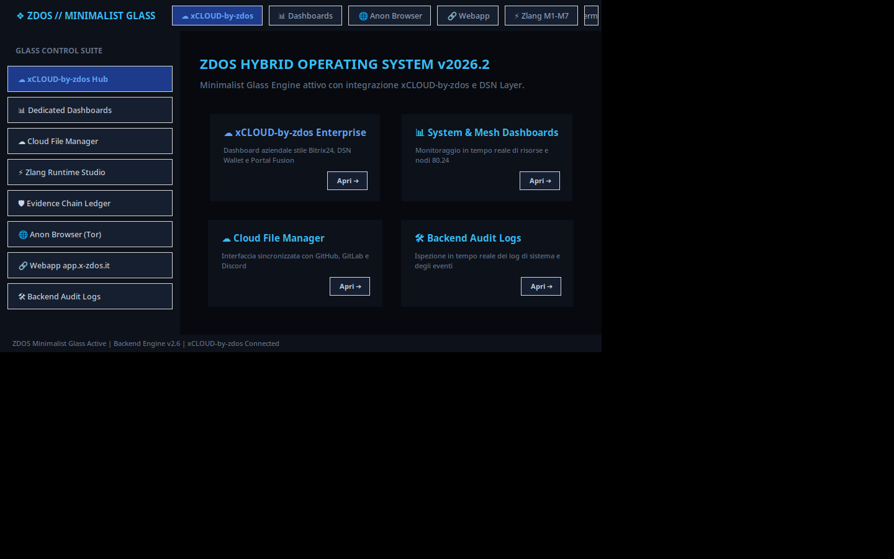
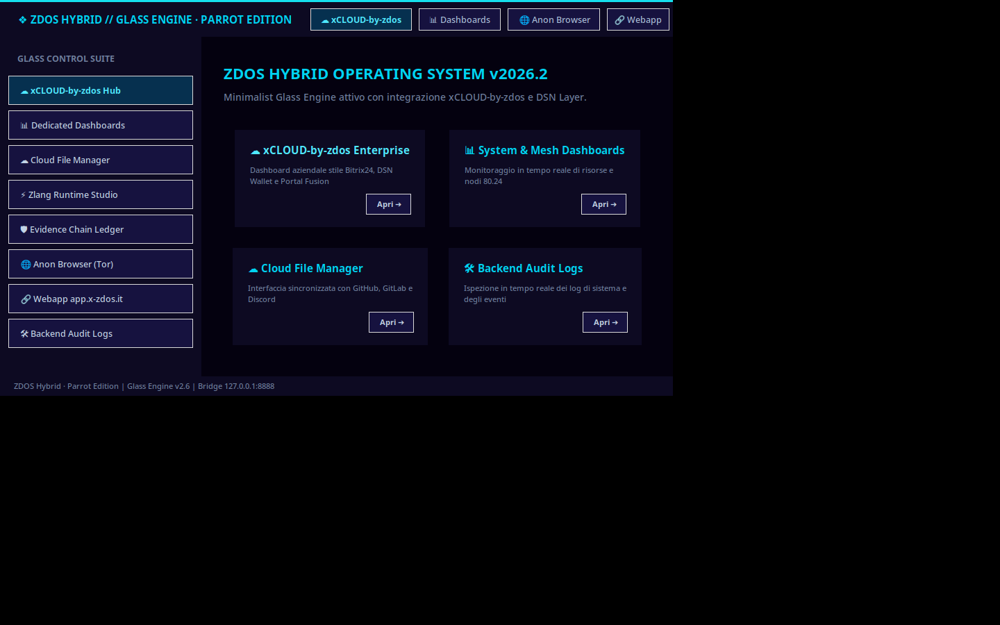

# Identità visiva · Parrot OS «Echo» per ZDOS Hybrid

Questo documento definisce l'identità visiva dell'interfaccia **ZDOS Hybrid
Security Workstation**. L'estetica precedente era mutuata da ambienti
Kali/teal (`#00ffcc`) con tinte GitHub-dark (`#0e1117`, `#38bdf8`): colori
funzionali, ma non coerenti con il nome che il launcher già dichiarava —
*Parrot Edition*.

L'obiettivo di questo intervento è rendere l'aspetto dell'interfaccia coerente
con **Parrot OS 7 «Echo»** (KDE Plasma 6, temi Flat Remix + Sweet Mars): fondo
notte viola-ink, ciano di marca, neon per gli stati attivi.

## 1. Fonti della palette

I codici colore non sono inventati: derivano da riferimenti pubblici verificabili.

| Fonte | Valore | Uso nel progetto |
|---|---|---|
| simple-icons, voce *Parrot Security* | `#15E0ED` | ciano di marca (accento primario) |
| parrotsec.org (CSS pubblico) | `#00FFF0` | neon, elemento attivo/focus |
| parrotsec.org | `#00D3F2`, `#00B8DB`, `#02ABB5` | accenti secondari, hover, bordi attivi |
| parrotsec.org | `#0A0118`, `#06043E`, `#0F0A1E`, `#0A0A1F` | fondi e superfici |
| parrotsec.org | `#8799B5` | testo attenuato |
| parrotsec.org | `#FEBE2D` | stato di attenzione / warning |

> Nota sul marchio: l'interfaccia **non** incorpora il logo ufficiale di Parrot.
> Viene adottata la *palette* come riferimento estetico, indicando Parrot OS
> come ispirazione. «Parrot» e il logo Parrot Security sono marchi dei
> rispettivi titolari.

## 2. Palette operativa

| Token | Valore | Ruolo |
|---|---|---|
| `bg_deep` | `#04010F` | sfondo applicazione (livello 0) |
| `bg` | `#0A0118` | fondo notte di marca |
| `panel` | `#0F0A1E` | pannelli, finestre figlie |
| `panel_alt` | `#131038` | pannelli sollevati, sidebar |
| `surface` | `#06043E` | indaco profondo per barre e header |
| `raised` | `#1B1647` | hover e bottoni neutri |
| `border` | `#1D2B4B` | bordi standard |
| `border_hi` | `#252A52` | bordi su hover |
| `text` | `#EAF6FF` | testo primario |
| `text_muted` | `#8799B5` | testo secondario |
| `text_dim` | `#6F7F9E` | metadati |
| `cyan` | `#15E0ED` | accento di marca |
| `cyan_hi` | `#00FFF0` | neon, voce attiva |
| `cyan_mid` | `#00D3F2` | link, titoli secondari |
| `cyan_dim` | `#00B8DB` | hover di accento |
| `teal` | `#02ABB5` | profondità ciano |
| `violet` | `#7C3AED` | secondario «Sweet Mars» |
| `ok` | `#3DDC97` | stato verificato |
| `warn` | `#FFC857` | attenzione |
| `alert` | `#FF5C7A` | errore |
| `on_cyan` | `#000000` | testo su fondo ciano pieno |

## 3. Tipografia

| Ruolo | Stack |
|---|---|
| Interfaccia | `Ubuntu` → `Segoe UI` → `system-ui` |
| Codice/terminali | `JetBrains Mono` → `Consolas` → `Courier New` |

Su Ubuntu il pacchetto `fonts-ubuntu` è già presente in quasi tutte le
installazioni desktop; `JetBrains Mono` è consigliato ma opzionale (Tkinter
ripiega automaticamente).

## 4. Elementi di riconoscimento

| Elemento | Implementazione |
|---|---|
| Barra di identità | linea ciano `#15E0ED` alta 3 px in cima alla finestra e alla pagina web |
| Badge di edizione | pill `PARROT EDITION` in ciano su fondo `rgba(21,224,237,.14)` |
| Voce attiva | bordo/glow ciano + barra interna di 3 px |
| Sfondo | gradiente notte + aloni radiali ciano/viola (solo webapp) |
| Banner CLI | riquadro doppio `╔═╗` con titolo neon e sottotitolo attenuato |

## 5. Dove è applicata

| Superficie | File |
|---|---|
| Glass Engine (GUI principale) | `zdos_omni_os.py` |
| Variante generata dall'autobuild | blocco heredoc in `zdos-autobuild.sh` |
| Widget ancorato al desktop | `z_kali_ui.py`, `z_kali_sovereign.py` |
| Dashboard e moduli Z-KALI | `zdos_master_dashboard.py`, `z_kali_megadrive.py`, `z_kali_ruby_city.py` |
| Core UI glass | `interface/glass/core_ui.py` |
| Management Hub web | `webapp/index.html`, `webapp/assets/style.css` |
| Launcher `zk` | `zdos_zk_launch.py` |
| Design system condiviso | `parrot_theme.py`, `assets/theme/parrot-tokens.json` |

## 6. Come si applica e si verifica

La palette era duplicata in nove file più i blocchi heredoc del generatore:
la conversione è tracciata e ripetibile.

```bash
python3 tools/apply-parrot-theme.py          # applica la mappatura vecchio→nuovo colore
python3 tools/apply-parrot-theme.py --check  # segnala i colori fuori palette
python3 tools/sync-autobuild-heredocs.py     # allinea i file generati all'autobuild
python3 parrot_theme.py                      # stampa banner e token correnti
```

## 7. Anteprima

| Prima (Kali-teal) | Dopo (Parrot «Echo») |
|---|---|
|  |  |

Le immagini sono generate riproducibilmente sotto Xvfb:

```bash
Xvfb :99 -screen 0 1440x900x24 &
DISPLAY=:99 python3 zdos_omni_os.py &
DISPLAY=:99 import -window root docs/theme/preview/glass-engine-parrot-edition.png
```

La variante scritta da `zdos-autobuild.sh` è verificata **identica** a quella del
repository e produce lo stesso aspetto (`preview/glass-engine-autobuild.png`).
